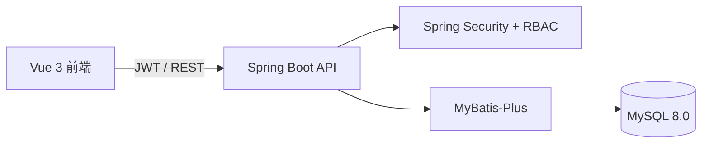
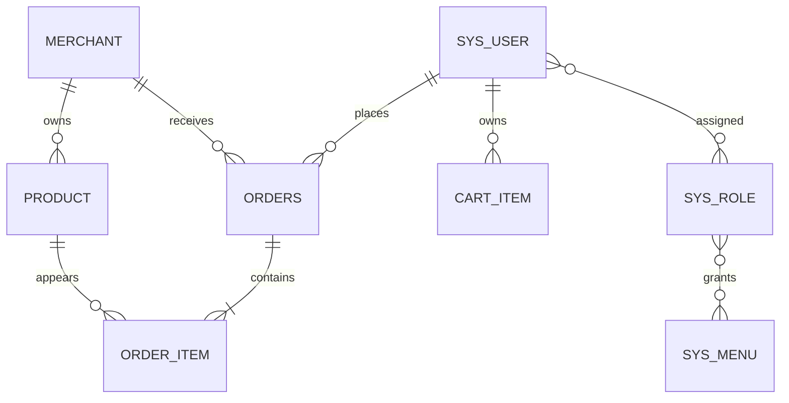

# 系统设计与验收材料

## 总体架构

前端负责商城、商家工作台和平台后台；后端负责认证授权、业务规则和事务；MySQL 保存商家、账号、商品、购物车、订单、订单明细和经营统计。

## 核心数据关系

## 权限矩阵

| 功能 | 消费者 | 商家 | 超级管理员 |
| --- | --- | --- | --- |
| 浏览在售商品 | 是 | 本店全部商品 | 全平台商品 |
| 购物车与下单 | 是 | 否 | 否 |
| 取消待发货订单 | 是 | 否 | 否 |
| 确认收货 | 是 | 否 | 否 |
| 商品价格、库存、上下架 | 否 | 本店 | 全平台 |
| 订单处理 | 查看本人订单 | 本店订单发货 | 查看全部订单 |
| 商家、用户启停用 | 否 | 否 | 是 |

## 订单状态规则

- 用户提交订单：`待发货`
- 商家发货：`待发货 -> 待收货`
- 用户确认收货：`待收货 -> 已完成`
- 用户取消订单：`待发货 -> 已取消`

状态不允许回退，商家也不能跳过发货直接完成订单。

## 安全设计

- 密码使用 BCrypt 保存。
- JWT 密钥只从环境变量读取，启动脚本每次生成随机本地密钥。
- 后端每次请求重新查询用户状态、商家状态和 `token_version`。
- 退出登录会递增 `token_version`，旧令牌立即失效。
- 权限由用户、角色、菜单权限关系表提供，后端接口继续执行角色和资源归属校验。

## 接口分组

| 接口 | 作用 |
| --- | --- |
| `POST /api/auth/login` | 登录并签发 JWT |
| `POST /api/auth/logout` | 退出并使当前令牌失效 |
| `GET /api/bootstrap` | 按角色加载对应数据 |
| `POST /api/cart/items` | 加入购物车 |
| `POST /api/orders/checkout` | 提交订单与收货信息 |
| `PATCH /api/orders/{id}/cancel` | 用户取消待发货订单 |
| `PATCH /api/orders/{id}/confirm` | 用户确认收货 |
| `PATCH /api/merchant/products/{id}` | 商家修改库存和商品资料 |
| `PATCH /api/merchant/orders/{id}/status` | 商家发货 |
| `PATCH /api/admin/**` | 超级管理员管理商家、商品和用户 |
